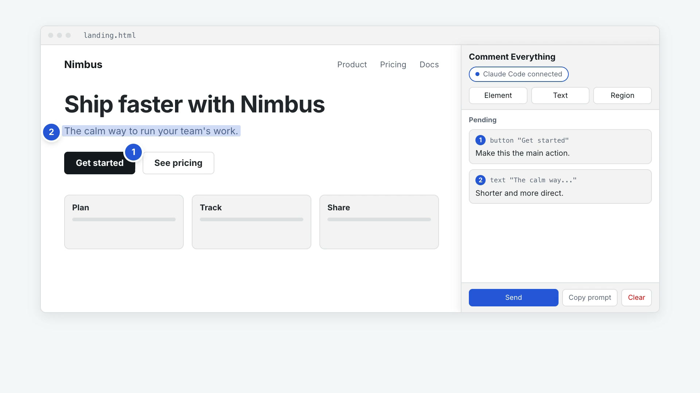
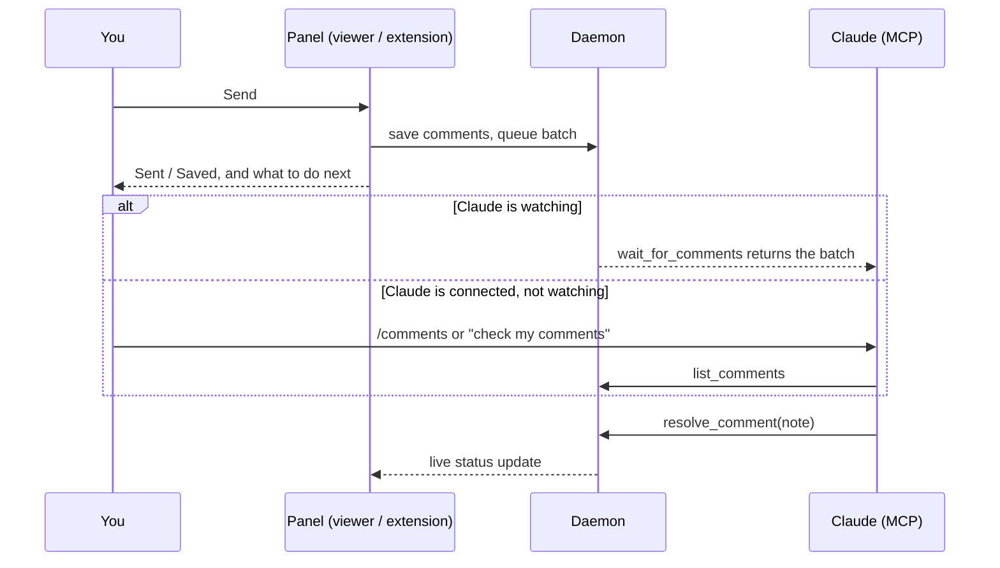

https://github.com/user-attachments/assets/f06a302d-2137-42d6-8923-a18f1f68a519

# Comment Everything

**Point at anything, say what should change, press Send. Claude does the edit.**

Comment Everything lets you leave review comments on HTML files, Markdown files, live web pages, and video or audio time ranges, then hands every comment (with its exact location, keyframes and transcript) to Claude Code, Claude Desktop, or any MCP agent. Everything runs on your machine: no account, no cloud.

[](https://github.com/hdduytran/comment-everything/releases/download/v0.1.0/comment-everything-intro.mp4)

▶ [Watch the 1-minute intro](https://github.com/hdduytran/comment-everything/releases/download/v0.1.0/comment-everything-intro.mp4) (English, with subtitles)


## Features

- **HTML**: pick elements or select text in a sandboxed render of the file. Comments store a CSS selector, XPath and a text quote.
- **Markdown**: comment on rendered text, code fences and Mermaid diagrams; comments map back to source line ranges.
- **Live web pages**: a Chrome extension adds the same overlay to any page (element, text or screenshot region). With the daemon it files the comments in the project that serves the page; on its own it keeps them in the browser and exports them for Claude.
- **Video and audio**: mark in/out ranges on a waveform with a thumbnail strip. The daemon extracts keyframes with ffmpeg and, when whisper.cpp is installed, a transcript of the range.
- **Multi-select**: collect many comments, then press **Send** once. They arrive as one batch.
- **Copy prompt**: produces a self-contained Markdown prompt to paste into any chat.
- **Re-anchoring**: when the file changes, comments follow their text (fuzzy quote matching) and are flagged `orphaned` if the content is gone.
- **Plain files**: one W3C Web Annotation style JSON file per comment in `<project>/.comments/`. Diffable, greppable, git-friendly.
- **Typing is safe on any page**: keystrokes in the comment box never reach the page's own keyboard shortcuts, and the panel collapses to a small handle when it is in the way.
- **Agent tools**: MCP tools `list_comments`, `get_comment`, `resolve_comment`, `set_status`, `wait_for_comments`.

## Quickstart

Requires Node 20 or newer.

**1. Open something and comment on it**

```sh
npx comment-everything open ./page.html     # also .md, .mp4, .webm, .mp3, ...
```

The viewer opens in your browser. Pick elements or select text, write a comment for each, press **Send**.

**2. Connect your agent** (pick one)

Claude Code plugin (MCP server, skill, `/comment-everything:comments` and `/comment-everything:comments-watch`):

```text
/plugin marketplace add hdduytran/comment-everything
/plugin install comment-everything@comment-everything
```

Or just the MCP server:

```sh
claude mcp add comment-everything -- npx -y comment-everything mcp
```

**3. Claude Desktop**

Easiest: download `comment-everything-<version>.mcpb` from the [latest release](https://github.com/hdduytran/comment-everything/releases/latest) and double-click it (or drag it into Claude Desktop → Settings → Extensions). Claude Desktop ships its own Node.js, so nothing else needs installing.

Or, with Node.js installed:

```sh
npx comment-everything init --write-desktop-config
```

This merges the server into Claude Desktop's config (existing servers are kept); restart Claude Desktop afterwards. Run `npx comment-everything init` without the flag to print setup snippets for Claude Code, Claude Desktop, Cursor and Codex instead of writing anything.

Then tell the agent: **"check my comments"**. It reads each comment, edits the referenced file or timestamp, and marks the comment resolved with a note. The viewer shows the resolution live.

## How Send reaches Claude

Pressing **Send** does not call Claude directly. It saves the comments and queues them in the local daemon; Claude picks them up through MCP.

1. **Connect Claude once** (see Quickstart). The panel header shows who is connected: "Claude Code connected · watching", "Claude connected (will read on request)", or "No AI connected". Select it for copy-paste setup commands.
2. **Press Send.** Comments are written to `<project>/.comments/` and queued as one batch.
3. **Claude reads the batch**, depending on how it is connected:
   - It is **watching** (`/comments-watch`, or a channel): it picks the batch up right away and the panel says "Sent — Claude is picking it up".
   - It is **connected but not watching**: tell it "check my comments" or run `/comments`. The panel says so.
   - **Nothing is connected**: the comments are saved, and the panel offers "How to connect". Connect later and ask Claude to check; nothing is lost.
4. **Claude edits the file and resolves each comment.** The status chips in the panel update live.



There are three ways the agent picks a batch up:

| Mode                            | How                                                                                                                                   | Notes                                                       |
| ------------------------------- | ------------------------------------------------------------------------------------------------------------------------------------- | ----------------------------------------------------------- |
| Pull (default)                  | Ask "check my comments", or run `/comment-everything:comments`. The agent calls `list_comments`.                                      | Works everywhere, including Claude Desktop.                 |
| Watch loop                      | `/comment-everything:comments-watch`. The agent loops on `wait_for_comments`, which returns the next batch as soon as you press Send. | Claude Code and any MCP client that allows long tool calls. |
| Push (opt-in, research preview) | Claude Code "channels": `mcp --channel` pushes each batch into the running session.                                                   | Needs a development flag, see below.                        |

Opt-in push:

```sh
claude mcp add comment-everything-channel -- npx -y comment-everything mcp --channel
claude --dangerously-load-development-channels server:comment-everything-channel
```

Caveats: channels are a Claude Code research-preview feature, interactive sessions only, and custom channels are not on the approved allowlist, which is why the development flag (and its confirmation dialog) is required. Without the flag the server still works but pushed events are dropped silently. A channel-mode server claims batches from the queue, so do not use `wait_for_comments` through the same server. Claude Desktop cannot receive pushes and stays pull-only.

## Chrome extension (live web pages)

The extension is not yet in the Chrome Web Store. Build and load it:

```sh
pnpm install && pnpm --filter @comment-everything/extension build
```

Open `chrome://extensions`, enable **Developer mode**, choose **Load unpacked**, select `packages/extension/dist`. Then click the toolbar button or press `Alt+Shift+C` on any page.

It works in two modes, chosen when you open the panel (and forceable in the extension's options page: **Auto**, **Standalone only**, **Daemon**):

- **Extension only** (no daemon, nothing to install). If nothing answers on `127.0.0.1:4317`, or this browser is not paired, the panel shows **Extension only** in its header and comments stay in this browser (`chrome.storage.local`, screenshots in IndexedDB). You hand them to Claude in one of three ways:
  1. **Copy prompt**: Markdown for any chat. When the comments include screenshots it copies a rich item (HTML with the images plus plain text), so pasting into Claude Desktop or claude.ai includes the images where the app supports it.
  2. **Export** (the primary button): saves `Downloads/comment-everything/<host>/<yyyy-mm-dd-hhmm>/comments.md`, `comments.json` and `assets/*.png`, then shows a sentence to give Claude Code: _read ~/Downloads/comment-everything/&lt;path&gt;/comments.md and apply_ (with a copy button).
  3. **Open in Claude**: copies the prompt, then opens a blank `https://claude.ai/new`. Nothing from your comments is put in the address.

  You can mark saved comments resolved yourself. Nothing leaves the browser.

- **Daemon** (automatic Send). Run `npx comment-everything serve`, press **Pair** in the panel (or the offer it shows when a daemon is running), confirm on the page the daemon opens, then pick the project folder that serves this site (remembered per origin). Comments land in `<project>/.comments/` with the page URL as `source`; pages not mapped to a project are stored under `~/.comment-everything/<host>/`. Comments you saved in extension-only mode are offered as **Move N to project**; the local copies are removed after the daemon accepts them.

More in [packages/extension/README.md](packages/extension/README.md).

## How it compares

Features only, taken from each project's public listing in November 2026; check the projects for current details and corrections are welcome.

|                              | Comment Everything                                                         | [Vibe Annotations](https://github.com/RaphaelRegnier/vibe-annotations) | [Claudback](https://chromeboard.com/extension/claudback-dbnmlcmmgnchigedlglfmchkendlcfgc) | [Frame.io](https://frame.io) |
| ---------------------------- | -------------------------------------------------------------------------- | ---------------------------------------------------------------------- | ----------------------------------------------------------------------------------------- | ---------------------------- |
| Local HTML files             | Yes                                                                        | Local dev pages                                                        | Web pages                                                                                 | Not its focus                |
| Markdown files (line-mapped) | Yes                                                                        | Not listed                                                             | Not listed                                                                                | Not its focus                |
| Live web pages               | Chrome extension                                                           | Chrome extension                                                       | Chrome extension                                                                          | Not its focus                |
| Video and audio time ranges  | Yes (ranges, keyframes, transcript)                                        | Not listed                                                             | Not listed                                                                                | Yes (time-coded review)      |
| Hand-off to AI agents        | MCP (stdio and HTTP), Claude Code plugin, opt-in channel push, copy prompt | MCP, copy to clipboard                                                 | MCP (Claude Code)                                                                         | Not its focus                |
| Where comments live          | JSON files in your project                                                 | Local companion server                                                 | `~/.claudback/`                                                                           | Hosted service               |
| Account required             | No                                                                         | No                                                                     | No                                                                                        | Yes                          |
| License                      | MIT                                                                        | PolyForm Shield 1.0.0                                                  | See listing                                                                               | Commercial                   |

## Security model

The daemon holds comments about your files and can read files in registered projects, so it is locked down:

- **Loopback only.** Binds `127.0.0.1`; requests whose `Host` is not the loopback daemon are rejected (DNS-rebinding defence).
- **Per-install token.** A random 256-bit token (stored at `~/.comment-everything/token`, mode 0600) is required on every API call except the health check and the viewer shell. Compared in constant time.
- **Origin guard.** Browser requests must originate from the daemon's own pages or from a `chrome-extension://` origin the user paired. Other websites cannot call the API, even with a token.
- **Paired extensions.** The extension only gets the token through an explicit pairing step on a page the daemon serves and you confirm. Only paired extension ids are accepted afterwards.
- **Scoped file access.** Files are served only from registered project roots; paths are resolved with `realpath` so `..` and symlinks cannot escape.
- **Sandboxed HTML.** Project HTML and SVG are served with a CSP `sandbox` and rendered in a sandboxed iframe with an opaque origin, so the page cannot call the daemon API or read the viewer.
- **Untrusted comment wrapping.** Comment text, page quotes and transcripts are untrusted (they can come from web pages or other reviewers). MCP tool output wraps all of it in `<untrusted_user_comment>` tags, neutralises attempts to close the tag, and tells the agent to treat the content as data. The bundled skill repeats this rule.
- **Local only.** No telemetry, no accounts, no remote servers.

**Known limitation.** The sandboxed iframe loads the file from `/s/<token>/files/...` so relative URLs (images, CSS) inside the page keep working. The token is therefore part of the frame's URL, and scripts running inside the page you are viewing can read it. With it, such a script can read other files under the same registered project root through the scoped file route, and could send the token elsewhere; a local process holding the token could then call the full API. The origin guard still stops other websites from calling the API from a browser, and the sandbox keeps the page away from the viewer itself. Open only HTML you trust, as you would in a browser, and run `comment-everything stop` when you are done. See [docs/architecture.md](docs/architecture.md#threat-model).

## Requirements

- Node 20 or newer.
- **ffmpeg** (optional): keyframes, thumbnails and scene-cut suggestions for video. Without it, comments are still saved and the viewer shows an install hint.
- **whisper.cpp** (optional): transcripts for audio and video ranges. Install `whisper-cli`, then point to it and a ggml model:

  ```sh
  export WHISPER_CLI=/path/to/whisper-cli      # optional if it is on PATH
  export WHISPER_MODEL=/path/to/ggml-base.en.bin
  ```

- Chrome 116 or newer for the extension.

## Documentation

- [Comment schema reference](docs/schema-reference.md)
- [MCP tools](docs/mcp-tools.md)
- [REST API](docs/rest-api.md)
- [Architecture](docs/architecture.md)
- [Contributing](CONTRIBUTING.md)

## License

[MIT](LICENSE)
