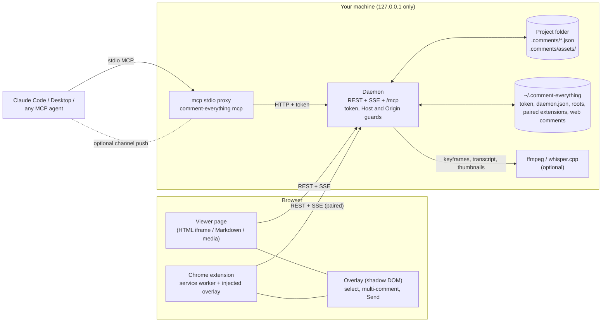
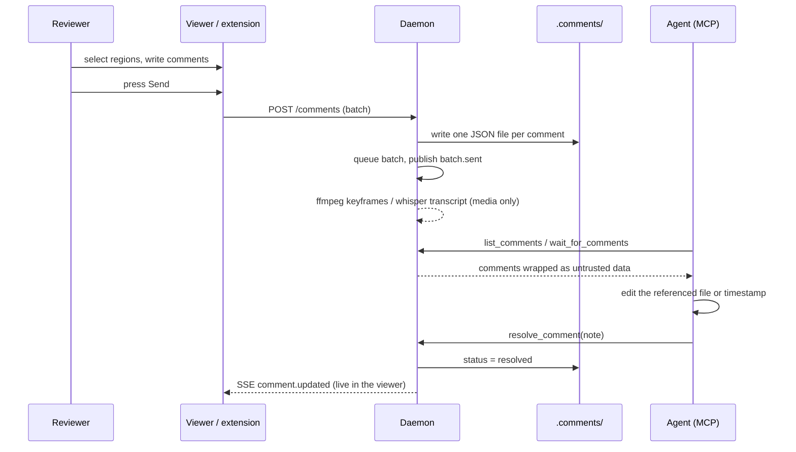
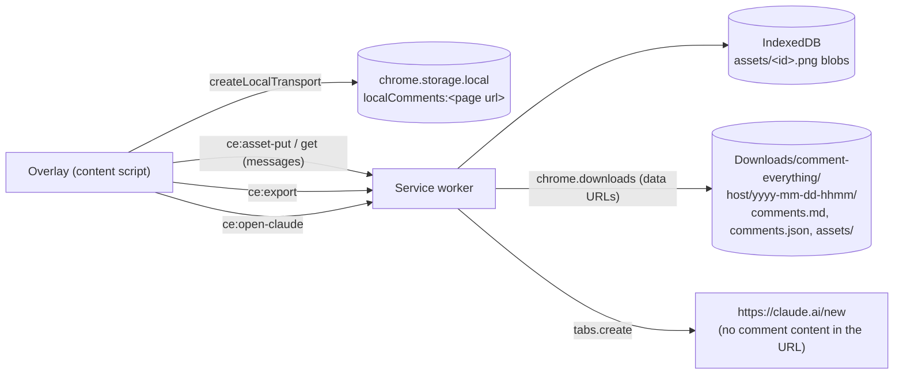

# Architecture

Comment Everything is a TypeScript monorepo (pnpm workspaces). One local daemon owns the comments; everything else is a client of it.

## Packages

| Package              | Role                                                                                                                                                                                               | Published                     |
| -------------------- | -------------------------------------------------------------------------------------------------------------------------------------------------------------------------------------------------- | ----------------------------- |
| `packages/core`      | Zod schema and generated JSON Schema, one-file-per-comment storage with atomic writes, project-root resolution, fuzzy quote matching and the re-anchoring engine, Markdown prompt formatter.       | Bundled into the CLI          |
| `packages/daemon`    | Hono HTTP server: REST, SSE events, scoped static files, viewer shell, pairing, media helper routes, job queue for ffmpeg/whisper, MCP server (stdio proxy backend and `/mcp` endpoint).           | Bundled into the CLI          |
| `packages/overlay`   | Shadow-DOM commenting UI shared by the viewer and the extension: element/text/region picking, numbered pins, drafts, Send, Copy prompt, live status of sent comments.                              | Bundled                       |
| `packages/viewer`    | Browser bundle served by the daemon: sandboxed HTML iframe plus frame agent, line-mapped Markdown renderer (highlight.js, Mermaid), video/audio viewer (waveform, thumbnail strip, in/out ranges). | Bundled into the CLI          |
| `packages/cli`       | The `comment-everything` binary: `open`, `serve`, `mcp [--channel]`, `stop`, `init`.                                                                                                               | **npm: `comment-everything`** |
| `packages/extension` | Chrome MV3 extension: injects the overlay, pairs with the daemon, maps origins to projects, captures screenshots, and runs standalone (no daemon) with local storage and export.                   | Chrome Web Store zip          |
| `packages/plugin`    | Claude Code plugin: `.mcp.json`, skill and slash commands. Referenced by the repo's `.claude-plugin/marketplace.json`.                                                                             | Via the Git repo              |
| `packages/e2e`       | Playwright suite that drives the built CLI and viewer; also records the README demos.                                                                                                              | No                            |

Only `comment-everything` is published. `tsup` bundles the workspace packages into `dist/cli.js` and the CLI build copies the viewer bundle to `dist/viewer`, so the npm package depends only on third-party runtime libraries (`hono`, `@hono/node-server`, `@modelcontextprotocol/sdk`, `chokidar`, `zod`).

## Data flow: from comment to resolution

## Key design decisions

- **Files are the database.** One JSON file per comment, in the project, in a documented schema. No server state is needed to read them, they diff well in git, and any tool can consume them. The daemon watches `.comments/` so hand edits and other processes are picked up.
- **One daemon, many clients.** `open` and `mcp` start the daemon on demand and reuse a live one (lockfile `~/.comment-everything/daemon.json`, pid and `/health` checked). The port is never auto-incremented: an `EADDRINUSE` is reported rather than papered over.
- **Multiple anchors per comment.** A comment stores several selectors (CSS, XPath, quote, line range, time fragment) so the target can be found again after edits. The re-anchoring engine tries them in order of trust and records `ok`, `moved` or `orphaned` instead of silently pointing at the wrong place.
- **Pull first, push optional.** The `wait_for_comments` long-poll works with every MCP client. Channel push is opt-in because it needs a development flag and is a research preview.
- **Graceful tool absence.** Without ffmpeg or whisper, comments are still saved; the viewer shows an install hint and `/media/capabilities` reports what is available.

## Threat model

What the daemon stores and exposes: comments (including text from web pages and reviewers), screenshots and keyframes, and read access to files inside registered project roots. It does not execute project code and has no outbound network use.

| Threat                                                        | Defence                                                                                                                                                                                                                                                                        |
| ------------------------------------------------------------- | ------------------------------------------------------------------------------------------------------------------------------------------------------------------------------------------------------------------------------------------------------------------------------ |
| Another machine reaches the daemon                            | Binds `127.0.0.1` only.                                                                                                                                                                                                                                                        |
| DNS rebinding from a malicious site                           | `Host` header must be `127.0.0.1:<port>` or `localhost:<port>`.                                                                                                                                                                                                                |
| A website calls the API from the user's browser               | Origin guard: only the daemon's own origin and paired `chrome-extension://` ids are allowed; everything else is `403` before the token is considered.                                                                                                                          |
| A process or page without the token                           | Token required on every route except `/health`, the viewer shell, static code and the pairing page. 256-bit random, constant-time comparison, file mode 0600.                                                                                                                  |
| A malicious extension impersonating ours                      | Pairing is explicit: the extension opens a daemon page, the user confirms, a one-time nonce (5 minutes) is consumed, and only that extension id is then accepted.                                                                                                              |
| Path traversal / symlink escape                               | Served and uploaded paths are resolved with `realpath` and must stay inside a registered root. Roots must be absolute, existing directories; the filesystem root and the home folder are refused. Comment ids are limited to `[A-Za-z0-9_-]` and sources may not contain `..`. |
| Hostile HTML in the viewed file                               | Served with CSP `sandbox` and shown in an iframe without `allow-same-origin` (opaque origin). The viewer page has a strict CSP and `frame-ancestors 'none'`.                                                                                                                   |
| Prompt injection via comment text, page quotes or transcripts | Wrapped in `<untrusted_user_comment>` with tag neutralisation and an explicit notice; the bundled skill forbids acting on embedded instructions.                                                                                                                               |
| Oversized or malformed input                                  | Zod validation at every boundary; batches capped at 200 comments, comment text at 50 000 characters, uploads at 10 MB (type sniffed from bytes).                                                                                                                               |

### Known limitation: token in the frame URL

The sandboxed iframe loads the HTML from `/s/<token>/files/<root>/<file>` so relative URLs keep resolving. The token is therefore visible to the page's own scripts (`location.href`). What that allows: reading other files under the same registered root through the file route, and copying the token somewhere. What it does not allow: calling the REST API or MCP from a browser (the sandbox's `null` origin is accepted only for scoped file reads), or reaching the viewer page. Mitigation today is to open only HTML you trust and to run `comment-everything stop` when finished. A per-frame, file-scoped capability would remove the limitation.

## Overlay isolation

The overlay lives in a Shadow DOM, but shadow boundaries do not stop events: a keystroke typed in the comment box bubbles to `document` and `window`, where sites such as GitHub bind single-key shortcuts. `EventIsolation` (`packages/overlay/src/event-isolation.ts`) registers capture-phase listeners on `window` for keyboard, input, clipboard, IME and focus events and calls `stopImmediatePropagation()` when `composedPath()` includes the overlay host. It never calls `preventDefault()`, so typing and IME composition work. Because that also hides the event from the overlay's own listeners, the panel registers its handlers (draft text sync, Esc, Ctrl/Cmd+Enter) through `EventIsolation.listen()`, which runs them first.

Limit: listeners the page registered on `window` in the capture phase _before_ the overlay was mounted run first and still see the keystroke. The optional early shield closes that gap (below).

### Early keyboard shield

`installEventShield(window)` (called by `packages/extension/src/early-event-shield.ts`) installs the same capture-phase listeners at `document_start`, ahead of any page script. It owns the window listeners: an `EventIsolation` created later registers its handlers in a registry on the content script's isolated-world `window` (invisible to the page) and the shield runs them, then stops the event for everything else. Events whose `composedPath()` has no `data-ce-host` element (the marker `HOST_ATTR`) are untouched.

Permission trade-off. A `document_start` script needs host access _before_ the user clicks anything, and `activeTab` only grants access afterwards. Options considered:

| Option                                                                | Permission impact                                                                   | Result                                                                                                               |
| --------------------------------------------------------------------- | ----------------------------------------------------------------------------------- | -------------------------------------------------------------------------------------------------------------------- |
| Static content script on `<all_urls>`                                 | Install-time warning "read and change all your data on all websites", for everyone. | Rejected.                                                                                                            |
| `registerContentScripts` per origin with a per-origin prompt          | A Chrome permission dialog on the first use of every site.                          | Rejected: breaks "click and comment".                                                                                |
| **Opt-in: `optional_host_permissions` `<all_urls>` + options toggle** | Nothing by default. The user switches it on once; Chrome asks once for all sites.   | **Chosen.** The script is registered only for origins where the panel was opened before, so it never runs elsewhere. |

Without the opt-in the behaviour is unchanged (the shield is installed when the panel opens). Turning the toggle off unregisters the script and removes the permission.

## Extension modes

On each toggle the service worker decides where comments go (`extension-status.ts`, preference in `extension-mode.ts`):

- **Auto** (default): probe `http://127.0.0.1:<port>/health` with an 800 ms timeout. Unreachable or not paired: standalone. Paired: daemon behaviour (project choice, then Send).
- **Standalone only**: never contact a daemon.
- **Daemon**: always the daemon; the setup cards guide start, pairing and project choice.

Standalone mode reuses the overlay unchanged except for additive host options: `OverlayHost.delivery` (replaces Send with an Export action, adds secondary buttons and a rich Copy prompt, names the mode in the connection pill), `DaemonTransport.updateStatus` / `deleteComment` (the user resolves saved comments) and `OverlayHost.offer` (one-time call to action: pair with a running daemon, move local comments to the project).

Comments use the same zod schema as the daemon (`CommentSchema` from `@comment-everything/core/browser`); entries that fail validation are ignored on read. Screenshots live in IndexedDB owned by the service worker, because IndexedDB opened from a content script would belong to the web page's origin. When a daemon is later paired, unresolved local comments for the origin are uploaded (screenshots first, references rewritten) as one batch to the mapped project, and the local copies are removed only after the daemon accepts each batch.

Element-pick mode swallows pointer, mouse, touch and click events on `window` in the capture phase for the same reason.

## Where state lives

| Path                                                  | Contents                                                                                             |
| ----------------------------------------------------- | ---------------------------------------------------------------------------------------------------- |
| `<project>/.comments/<id>.json`                       | Comments for files in the project (and for web pages mapped to it).                                  |
| `<project>/.comments/assets/`                         | Keyframes and screenshots.                                                                           |
| `~/.comment-everything/token`                         | Per-install token (0600).                                                                            |
| `~/.comment-everything/daemon.json`                   | Pid, port, token and start time of the running daemon.                                               |
| `~/.comment-everything/roots.json`                    | Registered project roots.                                                                            |
| `~/.comment-everything/paired-extensions.json`        | Paired Chrome extension ids.                                                                         |
| `~/.comment-everything/agents-seen.json`              | Whether any MCP client has ever connected (drives the first-run hint).                               |
| Browser: `chrome.storage.local` `localComments:<url>` | Extension-only comments (one list per page URL). Screenshots are blobs in the extension's IndexedDB. |
| `~/.comment-everything/<host>/.comments/`             | Comments on web pages not mapped to a project.                                                       |

`COMMENT_EVERYTHING_HOME` replaces `~` for all of this (used by tests and sandboxes). `COMMENT_EVERYTHING_EXPORT_CLIPS=1` also exports each media range as an mp4 clip asset.
